# 旷野 Godot 光影还原研究

2026-10-13 收尾，接续 2026-10-10／11 的实验。源码属于 `filisi/kuangye-original-godot-recovery-20261008`，工程是 `godot-prototype/`。原 Vue 主站、另一 `godot/` 实验与本原型分别维护。本轮没有改变存档格式、经济、任务条件或依赖。

在线入口：[Godot 光影预览](https://thysummer14.github.io/kuangye/godot-lighting/)。从镇上点小家，走到窗边选择「午后晴光／日落时分／温柔夜晚」。选择只保留在当前会话，换房仍保留，重新启动回到日间，不写存档。原型自己的进度保存仍沿用既有 v4 文件与旧档兼容规则，不读取原 Vue/Web/Android 数据，不自动搬运其他站点的进度。

## 展示基准与改造

原网页的基准是鼠尾草绿墙面、奶油色装饰、浅木地板、暖灯与浅奶油小芽。旧 Godot 小家偏褐，窗光是透明方片，小芽身体完全 unshaded，无法体现光向。

| 原网页 | Godot 改造前 | Godot 日间 |
|---|---|---|
| 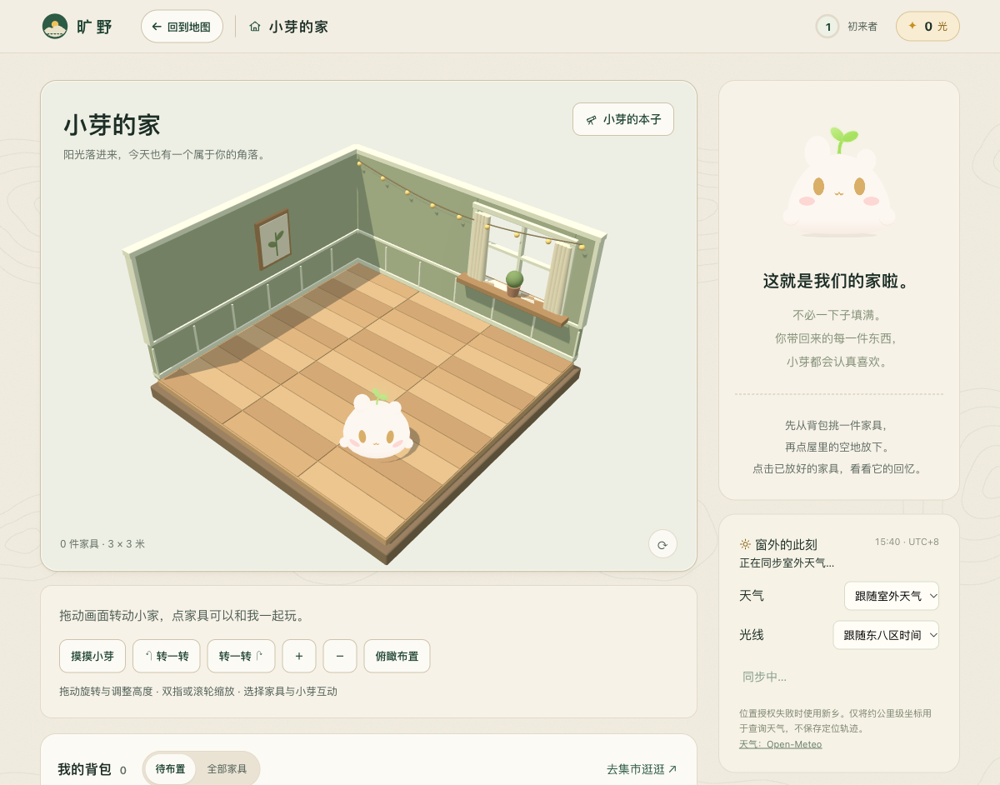 | 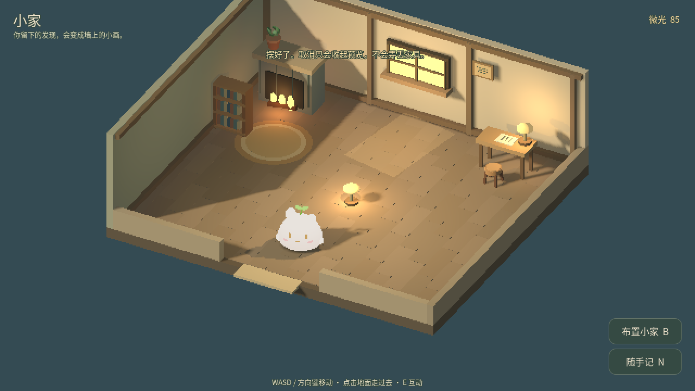 | 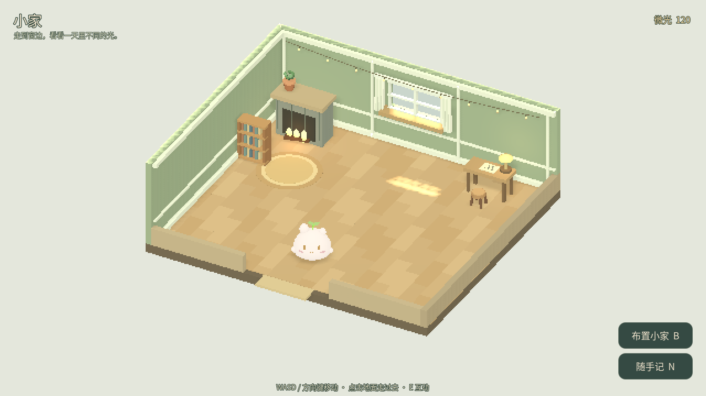 |

墙面、踢脚线、窗帘和地板恢复原网页的颜色关系，补上线灯。背墙的可见几何分段形成真实窗洞，碰撞继续保持完整；玻璃不投影，窗框实体参与投影。相机看不到的天花板只投影，遮住屋顶方向的日光。开放侧的补光承担剖面小家的阅读性，窗光由真实灯、窗洞和窗框产生，不再叠加透明矩形。

静态合批同时按材质、`cast_shadow` 和渲染层分组，保留只投影天花板及不投影地板的行为。窗玻璃的材质随模式变化，独立于静态批次。家具、角色、灯和碰撞代理继续独立维护。共面地板和道路接收阴影但不互相投影，避免拼缝变成黑线。

小芽的身体使用浅奶油 emission 底色加约 22% diffuse 响应，保留形象规范，同时表现场景光向；琥珀五官与粉色脸颊仍使用原面片。这个处理偏向美术可读性，不能据此宣称角色是完全物理材质。

## 三种光线

`scripts/lighting.gd` 集中声明显示参数，`world.gd` 应用；渲染层不决定奖励或存档。环境和日光共用 Compatibility 的 linear tonemapping。

| 模式 | ambient energy | sun energy | 室内灯倍率 | 画面意图 |
|---|---:|---:|---:|---|
| 午后晴光 | 0.64 | 0.85 | 0.22 | 淡暖日光穿过窗框，室内仍清楚 |
| 日落时分 | 0.46 | 0.72 | 0.65 | 暖橙光与较长窗框投影 |
| 温柔夜晚 | 0.29 | 0.24 | 1.00 | 蓝灰环境与局部暖灯，小芽仍为浅奶油 |

| 日间 | 黄昏 | 夜间 |
|---|---|---|
|  | 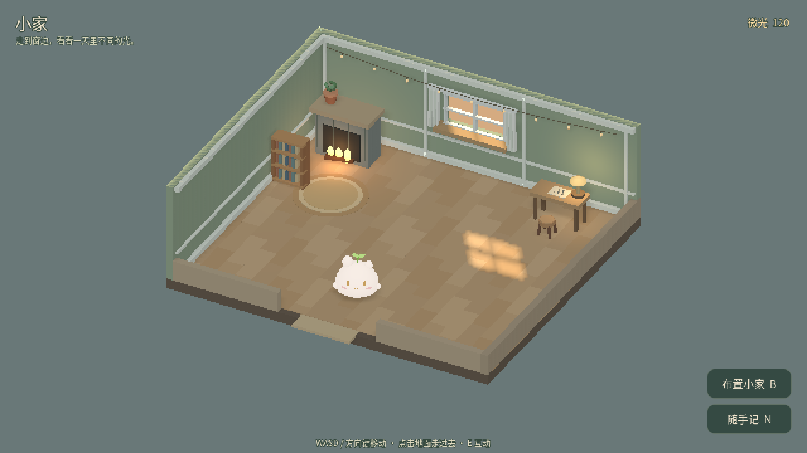 | 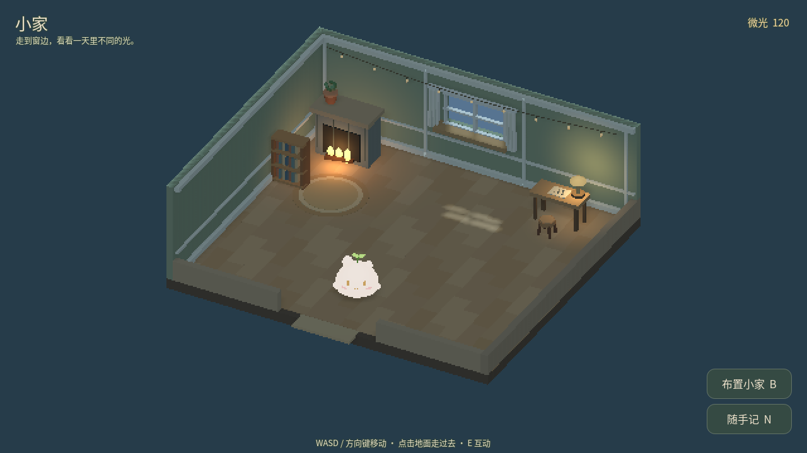 |
| 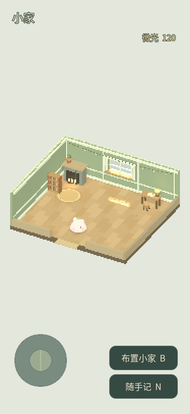 | 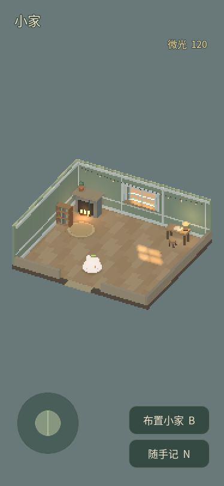 | 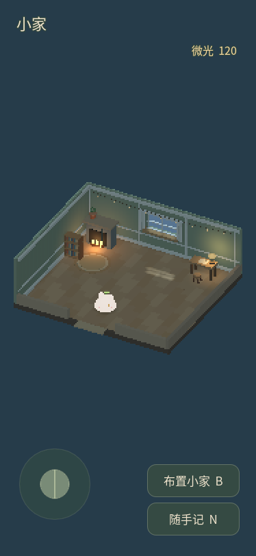 |

光线切换不会重建场景。新摆入的灯立即采用当前模式，局部灯沿用最多六盏预算。竖屏室内采用固定全房视角，避免角色走到窗边后裁掉房间。Web 按实际 `devicePixelRatio` 设置 UI 密度，375 CSS px／DPR 3 下按钮与面板仍按正常触控尺寸显示。根 Control 不再拦截场景鼠标点击，HUD 按钮仍消费自己的输入。

## 参考资料与独立实验

历史会话已读取用户提供的两份 Markdown 与实验 ZIP，原始文件的 SHA-256 是：

| 原始附件 | SHA-256 |
|---|---|
| `Pixel_Lighting_Lab_Findings_zh.md` | `986cf910c08309194f7eb018e03e9832163becad82e8c257786b4c611cc9be01` |
| `Pixel_Lighting_Lab_Godot46_Source_and_Evidence.zip` | `6d8d7f0d139fd8eb33d5202bd9dbcfbda7ca69eb241ef4c3374724a74ef975c4` |
| `HMCL_and_Pixel_Lighting_Followup_zh.md` | `969fc3bca6791feb73a048ad715a8f4eb680cc8c8e9f0510c5329d5acb204ec8` |

这些是 2026-10-11 留下的原附件校验记录；2026-10-13 的 Downloads 中已没有原件。现从此前解包目录保留了 [实验源码备份](lighting-evidence/reference-lab-source.zip)，含 MIT 许可和源码，ZIP 内附逐文件哈希。它是解包源码的重新归档，不能用上表的原始 ZIP 哈希校验。实验图片与 JSON 则从恢复快照保留，详见 [复现说明](lighting-evidence/lab-reproduction.md) 和 [像素比较](lighting-evidence/lab-pixel_validation.json)。

此前阅读的仓库研究入口：[光影、像素相机与遮挡复盘](https://github.com/ThySummer14/dusk-post-valley/blob/main/docs/DEVELOPMENT_LESSONS_ZH.md)、[水面研究](https://github.com/ThySummer14/dusk-post-valley/blob/main/docs/WATER_STUDY_ZH.md)。本轮采用法线、遮挡与固定机位方法，没有迁入水面代码或 Minecraft shader。

2026-10-10 的附件实验在本机 Godot 4.6.3 Compatibility／Apple M5 原生运行过。固定视角比较结果：

| 比较 | 变化像素 | 说明 |
|---|---:|---|
| 平法线 → 正确法线 | 9,880 | 法线改变表面受光 |
| 正确法线 → 翻转绿通道 | 10,713 | 坐标约定错误会改变光向 |
| alpha clip 开 → 关 | 7,096 | 裁剪决定卡片镂空与投影轮廓 |
| 阴影开 → 关 | 48,139 | 实体与灯的投受影需要分别验证 |
| 遮挡物有 → 无 | 1,975 | 真实几何承担遮挡 |
| 相同静态场景重复帧 | 0 | 此固定条件下输出一致 |

法线不提供真实厚度、碰撞或自遮挡；不应从已经带固定阴影的彩色图推导法线。Godot 的 OpenGL 切线空间约定和图像向下的 Y 轴需要显式对应。2D `PointLight2D.height` 改变虚拟入射方向，没有自动提供 3D 深度。这些结论用于检查本轮窗口、角色和投影；本轮没有把小芽改成带 normal map 的精灵。

## 本次验收

2026-10-13 重新执行的证据：

| 检查 | 结果与证据 |
|---|---|
| Godot 无图形回归 | 23／23 组；[摘要](lighting-evidence/headless-summary.json) 确认唯一临时项目与 `user://` 隔离 |
| 原生 1280×720 | 85／85；[参数与短样本](lighting-evidence/native-1280.json) |
| 原生 375×812 | 85／85；[参数与短样本](lighting-evidence/native-375.json) |
| Web 桌面与 DPR 3 触屏模拟 | 进屋、窗边选择、三种光线、家具预览／明确放下、进出房间；[浏览器验收](lighting-evidence/browser-qa.json) |
| Vue 原站 | `npm test` 138／138，`npm run build` 与 `check:release` 成功 |
| 交付工具 | 4／4；接受官方未压缩 Web 导出，保留许可并拒绝未知文件、存档与元数据 |

原生小家分别为 253／251 draw calls，三种模式的固定场景重复帧都一致。JSON 中的帧间隔来自 Apple M5 上每模式 60 帧的短样本，包含显示与调度因素，不代表纯 GPU 时长，也不用于预测实体手机或浏览器性能。第一次原生复测在窗口被完全遮挡后停在 `frame_post_draw`；改为 `--always-on-top` 保持窗口可见后，两种尺寸均成功完成。

触屏模拟实际拖动后，家具箱仍有一张小凳；明确「放下」后小凳从箱中移出，生成真实几何。刷新并重新进屋后，原摆放仍保留，光线回到日间；该证明只覆盖本次浏览器刷新，不能外推到进程关闭、存储回收或其他浏览器。控制台无错误，刷新时出现过需要用户手势启动 AudioContext 的浏览器提示。

| 窗边选择 | 拖动后仍为预览 | 明确放下 | 刷新恢复 |
|---|---|---|---|
| 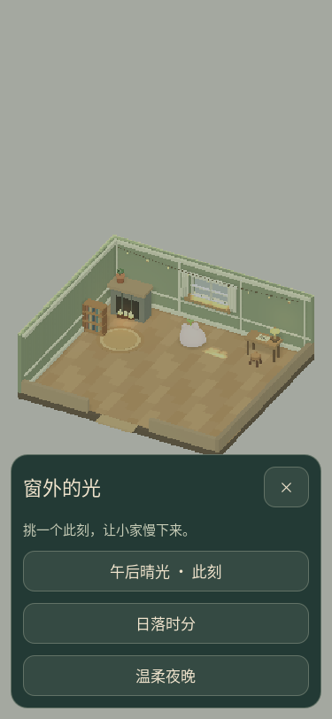 | 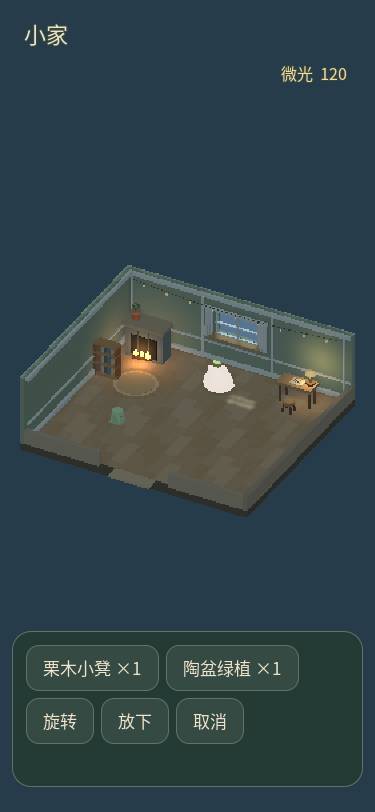 | 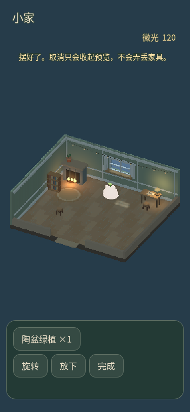 | 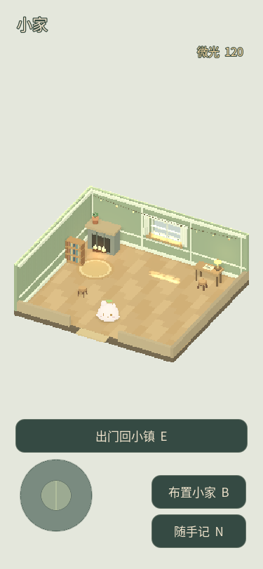 |

测试创建唯一命名的临时 Godot 工程，因为 macOS 的 `user://` 不能仅靠 `XDG_DATA_HOME` 隔离。runner 先探测实际目录名，确认隔离才运行旧档迁移测试；生产进度不参与测试。

## 复现与下一步

使用官方 Godot 4.6.3，从仓库根运行：

```sh
GODOT_BIN=/path/to/Godot python3 godot-prototype/tests/run_all.py
python3 godot-prototype/tests/test_package_delivery.py
npm test
npm run build
npm run check:release
```

原生图形测试也应在 `run_all.py` 的 `copy_qa_project` 所生成的唯一命名副本中运行，使用 `--always-on-top --script res://tests/test_lighting.gd`，竖屏追加 `-- --portrait`。没有图形输出的 headless 结果不能替代原生或 Web 画面。

Web 用单线程 Compatibility 导出，不需要 cross-origin isolation；正式文件、项目 MIT、字体 OFL 与完整 Godot 第三方声明保存在 `web/`。交付包用 `tools/package_delivery.py` 的显式白名单产生，包含源码、研究文档、图片证据、Web 与逐文件 SHA-256，排除缓存、凭证、Git 元数据和测试存档。

未完成的研究边界：实体 Android／iPhone 的触控遮挡、IME、持续温升、低端 GPU 帧时和浏览器进程关闭后重开尚未验收；没有验证 Minecraft 实际运行、角色 normal map 动画或水面效果。下一步先在实体手机沿「进屋 → 窗边三种光 → 拖家具 → 放下 → 重开」记录输入与帧时，再按真实问题决定光照预算和触控调整。
