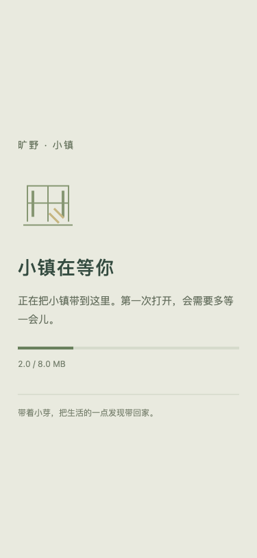
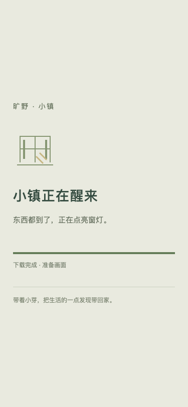
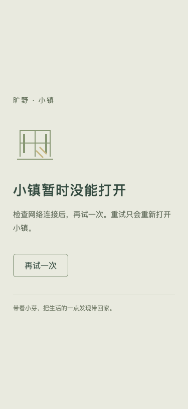
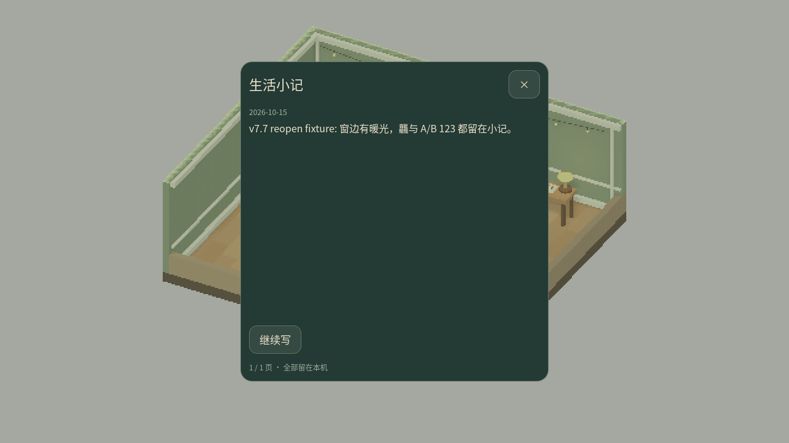
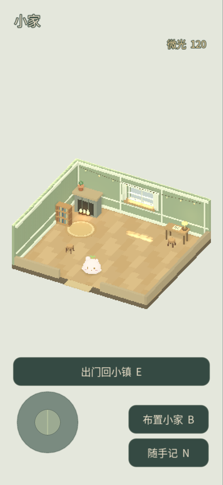
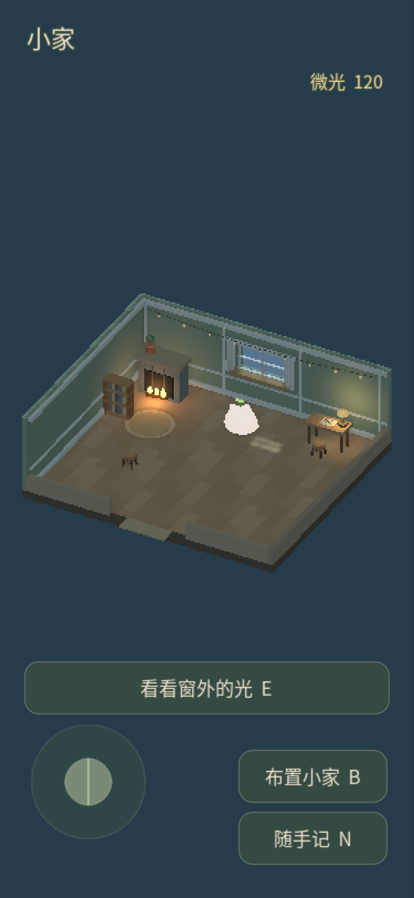
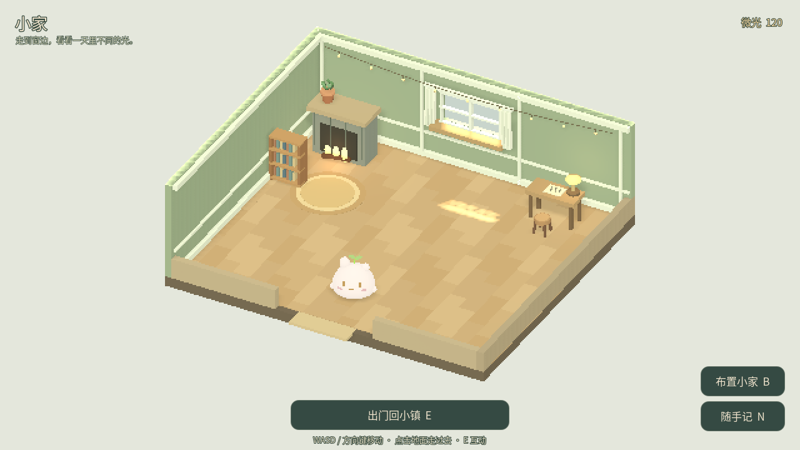
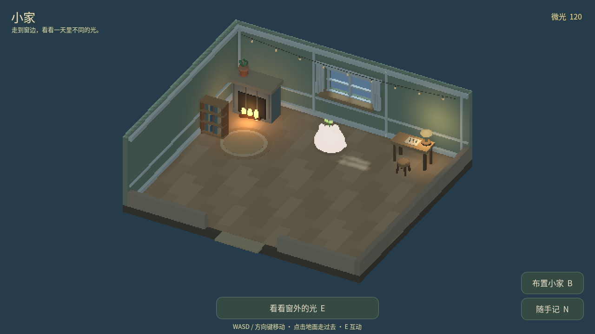

# Godot v7.7 · 首载与浏览器重开

2026-10-15。沿用 v7.6 的三种光线与独立 v4 存档，预览仍为 [godot-lighting](https://thysummer14.github.io/kuangye/godot-lighting/)。没有存档迁移、奖励变化或新增运行时依赖。

## 首载改动与测量

独立挂载 PCK 检查后，确认没有夹带文档、导出或原始字体副本；最大资源是导入后的中文字体。本轮把同一 Noto 字体封装为 WOFF2，原 OTF 留在源码供校验，Web 导出仅带新格式。Godot 4.6 的 [FontFile 文档](https://docs.godotengine.org/en/4.6/classes/class_fontfile.html) 列出 WOFF2 支持。使用本机已有 fontTools 4.66.1 一次性转换，构建直接使用提交的资源；字体继续遵守原 SIL OFL 1.1。

| 测量 | v7.6 | v7.7 |
|---|---:|---:|
| 字体来源文件 | 11,055,120 bytes OTF | 7,765,532 bytes WOFF2 |
| Web PCK | 14,543,232 bytes | 12,493,064 bytes |
| Web WASM | 37,700,666 bytes | 37,700,666 bytes |

PCK 减少 2,050,168 bytes（14.1%）。这衡量资源体积，不等同于网络或手机性能提升的百分比。完整保留 21,462 个 Unicode 字符映射、39,166 个字形顺序及水平度量，见 [字体证明](startup-evidence/font-proof.json)。Godot 内 14 项覆盖和三组文字四种字号尺寸相等；六张原生固定小家三光／两尺寸 PNG 与 v7.6 完全相同，见 [逐图哈希](startup-evidence/native-comparison.json)。

Web 改为暖纸色启动页，显示真实下载字节，未知总量时使用不定进度。下载完成后仍保留「小镇正在醒来」，直到引擎实际启动。引擎脚本失败、启动失败和缺少 WebGL 2 均有明确说明与重试；重试只重新载入页面。

| 下载中（375px） | 下载后启动 | 失败后重试 |
|---|---|---|
|  |  |  |

这些状态图使用模拟 Engine API，属于 HTML 组件检查，不冒充真实 WASM 下载测量。测试包含真实字节／比例、未知总量、完成后等待、失败后晚到进度不覆盖错误、重试保留本地标记、不支持环境不创建 Engine、脚本请求失败和 375px 无溢出。[Playwright 复测函数](startup-evidence/shell-fixture-playwright.js) 可作为 `playwright-cli run-code` 的参数执行（本地 8787 服务与 `output/playwright` 目录）。完整游戏另外使用真实官方 WASM/PCK 验收。

## 完整游戏与进程重开

Chromium 桌面和 375×812 CSS px／DPR 3（1125×2436 canvas）实际进屋、窗边换光、触摸拖家具、明确放下、门槛离开均通过。实际游戏控制台零错误；组件注入失败的预期错误单独记录。合成 Unicode keydown/up 输入保存中英文及「龘」，这不代表操作系统 IME 已验收。

在一次性持久化浏览器 profile 中，通过游戏 UI 写小记并放下小凳，然后完整关闭浏览器进程，确认旧 PID 消失，再以同一 profile 启动新进程；最终导出再次重复关闭／重开。IndexedDB `/userfs` 中原型 v4 文件前后均为 790 bytes，SHA-256 均为 `518a10f8a2ae91fcd509a2069175eddd9036e3b6df5694dc24d366d9fb517d48`，保留一条小记、125 微光、小凳坐标 (-5, 4) 与库存。没有把测试存档放进交付包；仅归档 [摘要回执](startup-evidence/persistence.json)。重开后从历史面板实际读回：

重开复测还发现 Web 初次读取的 DPR 可能早于 canvas／视口最终尺寸，导致 UI 暂时放大。现按 canvas 实际像素与 CSS 宽度计算密度，布局与周期检查都会重读。1280×720 下实时切换 DPR 2 → 1，无 reload，HUD 保持相同 CSS 尺寸；桌面／竖屏／高 DPI 回归也检查重新布局。

## 验证与边界

24/24 组隔离 Godot 回归（含字体 14 项）、原生桌面与 375px 各 85 项、打包 4 项、Vue 138 项及 build／check:release 均通过；[隔离摘要](startup-evidence/qa-summary.json)、[原生桌面](startup-evidence/native-1280.json)、[原生竖屏](startup-evidence/native-375.json) 保留具体结果。最终 Web `SHA256SUMS` 14 项通过。

| 真实 Web 日间（375px DPR 3） | 真实 Web 夜间（375px DPR 3） |
|---|---|
|  |  |

当前没有可连接的实体手机。真机触控、OS IME、温升和持续帧时仍待验收；本轮没有把浏览器模拟视口或 macOS 原生窗口记为手机验收。下一步先补 WebKit 完整游戏的同路径与持久化回归；实体设备可用后再按原真机清单执行。

## 发布回执

导出提交 `4c1a0fa758e579e6bd83b8c4cf1c3df39b43b91d` 已正常推送长期分支；main 配置提交 `0c4f300bb787d31c739a3dbfda4a311bd76a90f7` 的 [Pages Actions 38687379474](https://github.com/ThySummer14/kuangye/actions/runs/38687379474) build／deploy 成功。CI 重新通过 Vue 138 项与 release 检查，并校验 14 项导出清单。

公开地址的 1280×720／DPR 1 与 375×812／DPR 3 均实际启动、进屋、打开窗边选择并切换夜间，控制台零错误、无横向溢出。15 个线上文件完整 fetch 后以 Web Crypto SHA-256 与本地逐个比对，HTTP 200、字节数、哈希全部相同；不是只信任远端清单。见 [文件回执](startup-evidence/live-assets.json) 与 [部署回执](startup-evidence/deployment.json)。

| 线上桌面日间 | 线上桌面夜间 |
|---|---|
|  |  |

本轮完整交付包为 `kuangye-godot-v7.7-complete-20261015.zip`，位于本地忽略的 `exports/`，包含源码、官方 Web 导出、启动模板与验收证据；用打包工具逐文件哈希与 ZIP CRC 核对。它不包含测试存档、浏览器 profile、缓存或凭证。
